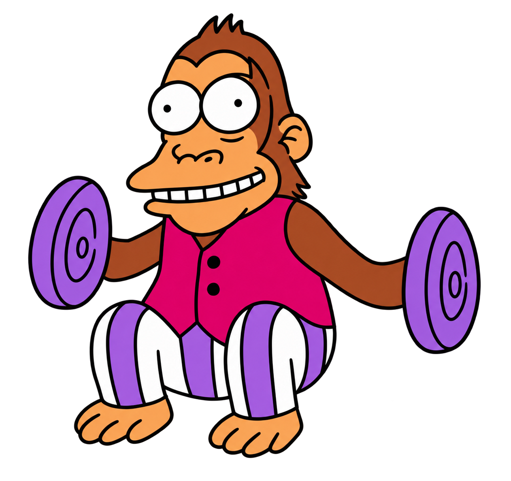

Imagina que tienes en tu casa el siguiente mono, lo vamos a llamar Paquito.

A Paquito le encanta tocar los platillos, esta todo el día liado con ellos.
Sin embargo, el dueño del mono piensa: ¿por qué no darle un ordenador y domesticarlo para que escriba los correos, conteste los mensajes no leídos, etc?

Así, le compra el nuevo macbook pro y se lo da.

Paquito está flipando, pero hay un GRAN PROBLEMA.

Es cierto que sabe tocar los platillos, pero habla un idioma que el ser humano no entiende y, por tanto, el dueño no le puede enseñar a utilizar el ordenador.

No obstante, el dueño de Paquito (pobre Paquito), gran fanático de Miguel Cervantes y de las matemáticas, piensa lo siguiente:

¿Qué pasaría si Paquito estuviera pulsando las teclas del macbook de manera infinita, solo parando para comer, hacer sus necesidades y dormir?

Él empieza a divigar y a pensar ...

Si el macbook pro tiene 78 teclas, ¿cuál es la probabilidad de que Paquito escribiera la palabra "quijote" pulsando teclas aleatoriamente?

La probabilidad de que la primera tecla pulsada sea "q" es $\frac{1}{78}$, y la probabilidad de que la segunda tecla pulsada sea "u" es también $\frac{1}{78}$, y así, sucesivamente. Por tanto, la probabilidad de 7 letras formando la palabra "quijote" es:

$$
\frac{1}{78} \times \frac{1}{78} \times \frac{1}{78} \times \frac{1}{78} \times \frac{1}{78} \times \frac{1}{78} \times \frac{1}{78} = \left(\frac{1}{78}\right)^7 = \frac{1}{1.7568 \times 10^{13}}
$$

Podemos ver, que aún así, el resultado no es cero, por tanto, es posible que pueda ocurrir.

Por otro lado, la probabilidad de no escribir la palabra "quijote" en 7 intentos es $1 - \left(\frac{1}{78}\right)^7$. Como los intentos son independientes, la probabilidad $X_n$ de no escribir "quijote" en ningún $n$ conjunto de 7 intentos es:

$$
X_n = \left(1 - \left(\frac{1}{78}\right)^7\right)^n
$$

Conforme $n$ crece, la probabilidad de NO escribir en $n$ bloques de 7 intentos la palabra "quijote", disminuye. Para $n=1$ millón, $X_n = 0,999999943$, pero para $n = 100$ billones, la probabilidad cae a $0,565923969$.

Por tanto, el dueño se dio cuenta que conforme el número de intentos que Paquito tenía pulsando teclas en el macbook, aumentaban, era problable que pudiera escribir cada una de las palabras que componen "Don Quijote de la Mancha".

Y así, el pobre Paquito

Dejó de ser Paquito

Para convertirse en Cervantes

