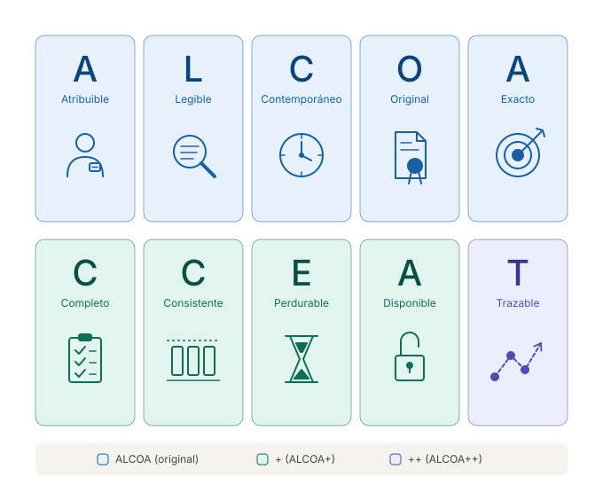

Leyendo la *Guideline on computerised systems and electronic data in clinical trials* de la EMA me encontré con un acrónimo que aparece una y otra vez: **ALCOA++**. Parece una sopa de letras, pero en realidad responde a una pregunta muy sencilla:

> ¿Cómo sé que puedo fiarme de un dato?

En un ensayo clínico, la respuesta importa mucho. De esos datos depende que un medicamento se apruebe o no y, sobre todo, la seguridad de los pacientes que participan. Por eso los inspectores no solo miran *qué* dice un dato, sino *cómo* se generó, quién lo tocó y si se puede reconstruir su historia.

## De dónde viene

El acrónimo original, **ALCOA**, se atribuye a Stan W. Woollen, de la FDA, en los años 90. Tenía cinco letras. Con el tiempo se le añadieron cuatro más (**ALCOA+**) y, finalmente, una décima: la trazabilidad (**ALCOA++**). Esta última versión es la que recoge la guía de la EMA, vigente desde septiembre de 2023.

## Las diez letras

| Letra | Principio | En una frase |
|-------|-----------|--------------|
| **A** | *Attributable* (atribuible) | Se sabe quién generó o modificó el dato y cuándo. |
| **L** | *Legible* (legible) | Se puede leer y entender, hoy y dentro de años. |
| **C** | *Contemporaneous* (contemporáneo) | Se registró en el momento en que ocurrió, no días después de memoria. |
| **O** | *Original* (original) | Es el primer registro (o una copia certificada), no una transcripción cualquiera. |
| **A** | *Accurate* (exacto) | Refleja fielmente lo que pasó, sin errores. |
| **C** | *Complete* (completo) | No falta nada, incluidos los metadatos y el historial de cambios. |
| **C** | *Consistent* (consistente) | Se registra de la misma forma siempre, con fechas y secuencias coherentes. |
| **E** | *Enduring* (perdurable) | Se conserva durante todo el tiempo exigido, sin degradarse. |
| **A** | *Available* (disponible) | Se puede consultar cuando hace falta, por ejemplo, en una inspección. |
| **T** | *Traceable* (trazable) | Se puede reconstruir toda su vida: de dónde viene y qué cambios ha sufrido. |

{fig-alt="Diez tarjetas con las letras de ALCOA++, el principio de cada una y un dibujo"}

## Un ejemplo para aterrizarlo

Imaginemos que en un estudio se toma una fotografía clínica de un paciente para evaluar una lesión:

- **Atribuible:** el sistema registra qué usuario hizo la foto (no vale una cuenta compartida por todo el equipo).
- **Contemporáneo:** la foto lleva la fecha y hora reales de captura, no la de cuando se subió al servidor una semana después.
- **Original:** se guarda el archivo tal como salió de la cámara. Si se recorta o se comprime, eso es una copia derivada y debe quedar indicado.
- **Completo:** junto a la imagen se conservan sus metadatos (dispositivo, resolución, paciente codificado…).
- **Trazable:** si alguien corrige la etiqueta de la imagen, queda un *audit trail* con el valor anterior, el nuevo, quién lo cambió, cuándo y por qué.
- **Perdurable y disponible:** la imagen sigue siendo accesible y legible años después, aunque cambie el software.

Si falla cualquiera de estos puntos, la foto puede ser perfecta desde el punto de vista técnico y aun así no servir como evidencia.

## Por qué es importante

ALCOA++ no es un requisito informático, sino una forma de pensar los datos. Un modelo de IA entrenado con datos que no cumplen estos principios hereda sus problemas: si no sé de dónde viene una imagen ni si la han modificado, tampoco puedo confiar del todo en lo que el modelo aprenda de ella. *Garbage in, garbage out*, pero con normativa europea detrás.

## Referencias

- European Medicines Agency (2023). *Guideline on computerised systems and electronic data in clinical trials* (EMA/INS/GCP/112288/2023). [Enlace al PDF](https://www.ema.europa.eu/en/documents/regulatory-procedural-guideline/guideline-computerised-systems-electronic-data-clinical-trials_en.pdf)